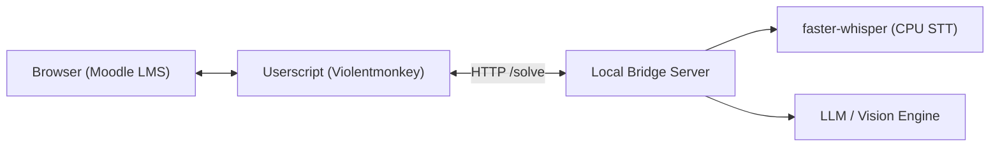

# Moodle AI Pilot

An autonomous multimodal AI assistant and automated evaluation framework for Moodle LMS. 

Designed for assistive learning, automated educational testing, and high-fidelity form emulation. Integrates local Speech-to-Text (`faster-whisper`), Vision-Language models, and browser DOM orchestration to solve and evaluate complex question types with natural human pacing.

---

## Key Features

- **Full Multimodal Question Support**:
  - **Cloze & Multianswer**: Sentence cloning with automatic `[BLANK_N]` extraction.
  - **Audio Listening Comprehension**: Real-time on-device speech transcription via `faster-whisper` and `ffmpeg` PCM streaming.
  - **Vision & Diagrams**: Multimodal image extraction and spatial reasoning.
  - **Drag and Drop (`ddwtos`, `ddimageortext`)**: Dual-layer synchronization (hidden input state and click-to-place event emulation).
  - **Dropdown & Gapselect**: Resilient selection with normalization of typographical apostrophes and whitespace.
  - **Multiple Choice & Short Answer**: Text-matching with substring and multi-token analysis.
- **Human-Paced Telemetry**:
  - Character-by-character typing with natural jitter (65-140 ms).
  - Randomized reading pauses between questions (12-25 s).
  - Submission safeguard: pauses autopilot if any question remains unfilled.
- **Section-Level Autopilot**:
  - Traverses entire course sections automatically: queue discovery -> attempt initiation -> answering -> submission -> review -> next quiz.
- **Multi-Provider Backend**:
  - OpenRouter (free and paid models).
  - Local Ollama / vLLM / LM Studio.
  - OpenAI direct API.

---

## Architecture



See [docs/ARCHITECTURE.md](docs/ARCHITECTURE.md) for full technical specifications.

---

## Quickstart Guide

### 1. Requirements

- Python 3.10+
- `ffmpeg` installed on your system PATH:
  ```bash
  # Arch / CachyOS
  sudo pacman -S ffmpeg
  # Ubuntu / Debian
  sudo apt install ffmpeg
  # macOS
  brew install ffmpeg
  ```
- Browser extension: [Violentmonkey](https://violentmonkey.github.io/) or [Tampermonkey](https://www.tampermonkey.net/)

### 2. Run the Local Bridge Server

Clone the repository and install dependencies using `uv` or `pip`:

```bash
git clone https://github.com/ijstt/moodle-ai-pilot.git
cd moodle-ai-pilot

# Using uv (recommended)
uv venv .venv
source .venv/bin/activate
uv pip install -r backend/requirements.txt

# Or standard pip
python -m venv .venv
source .venv/bin/activate
pip install -r backend/requirements.txt
```

Set your model provider credentials:

```bash
# For OpenRouter:
export OPENROUTER_API_KEY="your-api-key"

# Or for local Ollama:
export OLLAMA_BASE_URL="http://127.0.0.1:11434"
export OLLAMA_MODEL="llama3.2"
```

Start the bridge:

```bash
python backend/bridge.py --port 8765
```

### 3. Install the Userscript

1. Open Violentmonkey / Tampermonkey in your browser.
2. Create a new userscript and paste the contents of [`userscript/moodle-pilot.user.js`](userscript/moodle-pilot.user.js).
3. If necessary, adjust the `@match` pattern to match your institution's LMS domain (e.g., `*://moodle.your-university.edu/*`).
4. Save the userscript (`Ctrl + S`).

### 4. Usage

1. Open any Moodle course section or quiz page.
2. The **Moodle AI Pilot** panel will appear in the top-right corner.
3. Choose:
   - **[ Start Section Autopilot ]**: Scans the current section, queues all uncompleted exercises, and sequentially solves them.
   - **[ Solve Current Quiz Only ]**: Solves all questions on the active page without automatic navigation.

---

## Ethical Use and Disclaimer

This project is created strictly for educational evaluation, research in human-computer interaction, and assistive technology for users with motor or cognitive impairments. Users are solely responsible for ensuring compliance with their educational institution's academic integrity policies and terms of service.

---

## License

MIT License. See [LICENSE](LICENSE) for details.
