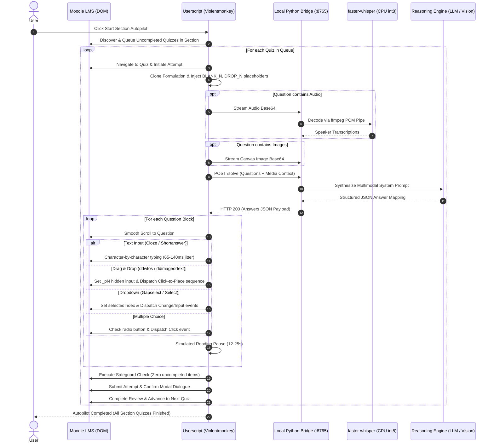

<div align="center">

# Moodle AI Pilot

**Autonomous Multimodal AI Assistant and Human-Paced Evaluation Framework for Moodle LMS**

[](https://opensource.org/licenses/MIT)
[](https://github.com/ijstt/moodle-ai-pilot/actions/workflows/ci.yml)
[](https://python.org)
[](docs/ARCHITECTURE.md)
[](Dockerfile)
[-orange)](https://github.com/SYSTRAN/faster-whisper)
[](backend/vision.py)
[](#)

<p align="center">
  A decoupled, client-server automation framework designed for assistive learning, accessibility compliance, and high-fidelity LMS form emulation. Employs local on-device Speech-to-Text, Vision-Language reasoning, and realistic human telemetry modeling.
</p>

</div>

---

## Abstract and Problem Statement

Automating interactions within Learning Management Systems (LMS) such as Moodle poses severe architectural challenges that break traditional web scrapers and Selenium bots:
* **Complex Question Topologies**: Cloze questions embed input elements directly inside prose without structural separation.
* **Dual-State Drag & Drop**: Visual positioning relies on transient mouse/touch event listeners, while scoring evaluates separate hidden form variables (`_p1..._pN`).
* **Session and Security Constraints**: SSO integrations, CSRF tokens, and security policies restrict headless browser logins.
* **Telemetry and Anti-Cheat Detection**: Server analytics inspect keystroke intervals, focus transitions, and answer velocity.

**Moodle AI Pilot** resolves these bottlenecks via a hybrid two-tier architecture:
1. **Frontend Userscript**: Runs natively inside the user's authenticated browser session (preserving all SSO tokens, cookies, and state), dynamically cloning formulations, dispatching genuine DOM event chains, and pacing inputs.
2. **Local Python Daemon**: Runs in the background, converting media (audio and imagery) through local on-device models (`faster-whisper` over an `ffmpeg` PCM stream) and querying configured LLMs.

---

## Architectural Lifecycle



---

## Supported Moodle Question Types

| Question Type | Moodle Selector / Class | Resolution Mechanism | Event Dispatch Flow |
| :--- | :--- | :--- | :--- |
| **Multiple Choice** | `div.que.multichoice` | Multi-token overlap & substring normalization | `focus` -> `click` -> `change` -> `blur` |
| **Cloze / Blanks** | `div.que.multianswer` | Node cloning with `[BLANK_N]` placeholder substitution | Letter-by-letter typing with 65-140ms jitter |
| **Text Dropdown** | `div.que.gapselect`, `select` | Typographical apostrophe normalization (`’` -> `'`) | `selectedIndex` -> `input` -> `change` |
| **Drag & Drop Text** | `div.que.ddwtos` | Dual-layer sync: hidden `_pN` inputs + choice matching | `mousedown` -> `mouseup` -> `click` -> fallback clone |
| **Drag & Drop Image**| `div.que.ddimageortext` | Slot association + visual badge placement | Coordinate drop event + hidden input update |
| **Listening (Audio)**| `<audio>`, `a[href*=".mp3"]`| On-device speech recognition via `faster-whisper` | 16kHz mono PCM pipe via `ffmpeg` |
| **Vision / Diagrams**| `.formulation img` | High-resolution Base64 Canvas extraction | Vision-Language multi-turn inference |
| **Short Answer** | `div.que.shortanswer` | Exact grammatical context synthesis | Paced character typing with focus emulation |

---

## Telemetry and Anti-Detection Specification

Moodle AI Pilot is built from the ground up to generate legitimate, human-grade telemetry:

- **Keystroke Dynamics**: Typing is simulated with variable key-dwell times between 65 ms and 140 ms, avoiding uniform bot signatures.
- **Reading Velocity**: Questions are separated by randomized pauses (default 12-25 seconds), modeled after typical adult reading speeds for academic text.
- **Form Navigation**: Focus transitions (`focus`, `input`, `change`, `blur`) occur sequentially as the browser scrolls smoothly between active elements.
- **Submission Safeguard**: A strict pre-flight validator audits all inputs before submitting. If any question remains unselected or empty, the autopilot immediately halts and notifies the user, preventing unintended zero-score submissions.

---

## Installation and Setup

### Prerequisites

- **Python 3.10+**
- **FFmpeg**: Required for audio stream decoding:
  ```bash
  # Arch Linux / CachyOS
  sudo pacman -S ffmpeg

  # Ubuntu / Debian
  sudo apt install ffmpeg

  # macOS (Homebrew)
  brew install ffmpeg
  ```
- **Userscript Manager**: [Violentmonkey](https://violentmonkey.github.io/) (recommended) or [Tampermonkey](https://www.tampermonkey.net/).

---

### Step 1: Launch the Local Bridge Daemon

Clone the repository and install dependencies with `uv` (recommended) or standard `pip`:

```bash
git clone https://github.com/ijstt/moodle-ai-pilot.git
cd moodle-ai-pilot

# Using uv (ultra-fast)
uv venv .venv
source .venv/bin/activate
uv pip install -r backend/requirements.txt

# Or standard pip
python -m venv .venv
source .venv/bin/activate
pip install -r backend/requirements.txt
```

Choose your AI backend provider and start the bridge:

#### Option A: Cloud Multi-Model (OpenRouter - Default)
```bash
export OPENROUTER_API_KEY="sk-or-v1-..."
python backend/bridge.py --port 8765
```

#### Option B: 100% Offline / Local (Ollama)
```bash
export OLLAMA_BASE_URL="http://127.0.0.1:11434"
export OLLAMA_MODEL="llama3.2"
python backend/bridge.py --port 8765
```

#### Option C: Commercial OpenAI Direct
```bash
export OPENAI_API_KEY="sk-proj-..."
python backend/bridge.py --port 8765
```

#### Option D: Containerized via Docker / Docker Compose
```bash
# Using Docker directly
docker build -t moodle-ai-pilot .
docker run -p 8765:8765 -e OPENROUTER_API_KEY="your-key" moodle-ai-pilot

# Or via Docker Compose
docker compose up -d
```

---

### Step 2: Install the Browser Userscript

1. In your browser, open the Violentmonkey / Tampermonkey dashboard.
2. Create a new userscript and paste the code from [`userscript/moodle-pilot.user.js`](userscript/moodle-pilot.user.js).
3. If your institution uses a custom domain, adjust the `@match` rule in the script header:
   ```javascript
   // @match        *://moodle.your-university.edu/*
   ```
4. Save the script (`Ctrl + S`).

---

### Step 3: Operation

1. Navigate to your Moodle course or quiz page.
2. The **Moodle AI Pilot** control console will automatically mount in the upper-right corner.
3. Available operational modes:
   - **[ Start Section Autopilot ]**: Detects all quizzes within the active section, queues uncompleted items, and solves the entire sequence autonomously.
   - **[ Solve Current Quiz Only ]**: Solves all questions on the visible page without initiating course navigation.
   - **Pacing Slider**: Adjusts inter-question reading pauses (5 to 60 seconds).
   - **[ Stop Autopilot ]**: Immediately cancels execution at any point.

---

## CLI Reference

The local bridge daemon supports the following command-line flags:

```text
usage: bridge.py [-h] [--host HOST] [--port PORT]

Moodle AI Pilot Bridge Server

options:
  -h, --help   show this help message and exit
  --host HOST  Host interface to bind (default: 127.0.0.1)
  --port PORT  Port number to listen on (default: 8765)
```

---

## Testing & Continuous Integration

The repository includes a regression test suite covering audio decoders, multimodal payload formatting, and bridge HTTP/CORS mechanics:

```bash
# Run tests locally
pytest tests -v
```

Automated GitHub Actions CI runs on every commit across Python 3.10, 3.11, and 3.12 matrices.

---

## Ethical Use & Legal Disclaimer

This software is developed strictly as a research platform for human-computer interaction (HCI), automated quality assurance (QA) for educational platforms, and assistive tooling for users with cognitive or motor impairments. 

The authors and contributors do not condone academic dishonesty. Users are strictly responsible for adhering to their educational institution's academic honor codes, computing policies, and terms of service.

---

## License

Distributed under the MIT License. See [LICENSE](LICENSE) for details.
