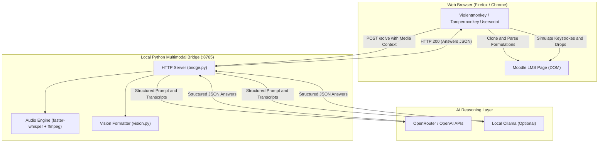

# Architecture of Moodle AI Pilot

## High-Level System Overview

Moodle AI Pilot decouples DOM extraction and human-like input emulation from backend multimodal reasoning and speech transcription:

## Core Modules

### 1. Cloze / Multianswer Formulation Cloning
Moodle's standard `qtype_multianswer` places inputs directly inside sentence text. Extracting text directly produces joined or distorted words. Moodle AI Pilot clones the formulation DOM node and replaces inputs with indexed tokens:
- `<input type="text">` -> `[BLANK_1]`, `[BLANK_2]`
- `<select>` -> `[SELECT_1]`, `[SELECT_2]`
- `` -> `[DROP_1]`, `[DROP_2]`

The LLM receives full semantic sentences with explicit target slot numbers.

### 2. Audio Processing (Whisper + ffmpeg Pipe)
Moodle audio files (mp3/ogg) are captured as Base64 blobs via `GM_xmlhttpRequest`. Rather than using high-level container libraries that fail across Python CPython builds, `audio.py` streams 16kHz mono s16le PCM data through an `ffmpeg` subprocess directly into `faster-whisper`. Transcription completes in ~1-2 seconds on CPU.

### 3. Drag and Drop Emulation
Moodle's `qtype_ddwtos` and `qtype_ddimageortext` require dual-level synchronization:
1. **Form State**: Setting hidden input values (`_p1`, `_p2`) corresponding to choice identifiers.
2. **UI State**: Triggering accessibility click-to-place event sequences (`mousedown` -> `mouseup` -> `click` on choice, followed by target zone).

### 4. Telemetry Modeling
To ensure natural server-side access logs:
- Keystroke events (`input`, `change`, `focus`, `blur`) are dispatched with randomized 65-140ms delays.
- Delays between consecutive questions vary naturally (12-25 seconds).
- Safeguards prevent automated submission if any question remains unfilled.
